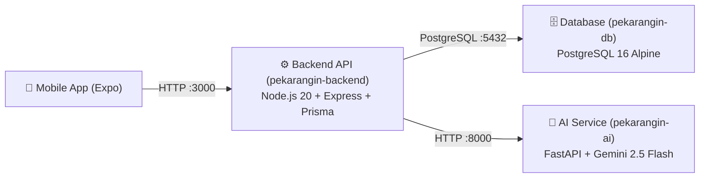

# 🐳 Pekarang.in — Infrastructure & Docker Orchestration
> **Orkestrasi Container Full-Stack untuk Platform Smart Urban Farming Pekarang.in**  
> *Kompetisi Multimedia and Game Event (MAGE) 12 — Institut Teknologi Sepuluh Nopember (ITS)*

Repository ini berisi konfigurasi **Docker Compose** dan manajemen infrastruktur untuk menjalankan seluruh ekosistem layanan Pekarang.in (PostgreSQL, Backend REST API, dan AI Microservice) dalam satu perintah terpadu.

---

## 🏗️ Arsitektur Layanan (Containers)



| Service | Container Name | Image / Base | Port Default | Deskripsi |
|---|---|---|---|---|
| **`postgres`** | `pekarangin-db` | `postgres:16-alpine` | `5432` | Database utama dengan volume persisten (`pekarangin-pgdata`). |
| **`ai-service`** | `pekarangin-ai` | `python:3.11-slim` | `8000` | Microservice AI (Gemini Vision, Chatbot, Scraper Harga & Scoring). |
| **`backend`** | `pekarangin-backend` | `node:20-alpine` | `3000` | Core REST API, Prisma ORM, Auto-migrate & Seed saat startup. |

---

## 📂 Struktur Direktori Workspace

Konfigurasi `docker-compose.yml` mengasumsikan seluruh repository berada di dalam satu parent directory (*sibling directories*):

```text
pekarangin-workspace/
├── be-pekarangin/        ← Backend Express.js + Prisma + Dockerfile
├── ai-pekarangin/        ← AI FastAPI + Gemini + Dockerfile
├── fe-pekarangin/        ← Mobile App (React Native Expo)
└── infra-pekarangin/     ← Repository ini (Docker Compose & Env)
```

Jika belum meng-clone seluruh repo:
```bash
mkdir pekarangin-workspace && cd pekarangin-workspace
git clone https://github.com/Pekarangin/be-pekarangin.git
git clone https://github.com/Pekarangin/ai-pekarangin.git
git clone https://github.com/Pekarangin/infra-pekarangin.git
```

---

## 🚀 Cara Menjalankan (Quick Start)

### 1. Setup Environment Variables
Masuk ke folder `infra-pekarangin/` dan salin file `.env.example` menjadi `.env`:
```bash
cd infra-pekarangin
cp .env.example .env
```
Edit `.env` dan isi `GEMINI_API_KEY` serta konfigurasi rahasia lainnya (`JWT_SECRET`).

### 2. Jalankan Mode Development (Hot-Reload)
Perintah ini akan membangun image, menyalakan PostgreSQL, AI Service, menjalankan `prisma db push` & `prisma/seed.js` secara otomatis, lalu menyalakan server API:
```bash
docker compose up --build -d
```

### 3. Jalankan Mode Production
Gunakan file override `docker-compose.prod.yml` untuk menjalankan container tanpa bind-mount source code dan menggunakan build production:
```bash
docker compose -f docker-compose.yml -f docker-compose.prod.yml up --build -d
```

---

## 🌐 Endpoint & Dokumentasi Layanan

Setelah seluruh container berstatus `healthy` / `running`:
- **Backend REST API:** `http://localhost:3000/api/v1`
- **Backend Health Check:** `http://localhost:3000/api/v1/health`
- **Scalar API Documentation:** `http://localhost:3000/docs`
- **AI Microservice Swagger UI:** `http://localhost:8000/docs`
- **AI Health Check:** `http://localhost:8000/health`

---

## 🛠️ Perintah Docker Bermanfaat

```bash
# Cek status seluruh container & healthcheck
docker compose ps

# Lihat log real-time semua service (atau spesifik)
docker compose logs -f
docker compose logs -f backend
docker compose logs -f ai-service

# Hentikan seluruh container (data database tetap aman)
docker compose down

# Hentikan container dan HAPUS seluruh data volume database (Reset Total)
docker compose down -v
```

---

## 👥 Tim Pengembang (MAGE 12 ITS)
* **Backend & Infra:** Andy Setiawan
* **Frontend Mobile:** Davin
* **AI & Data:** Aditya Pratama
